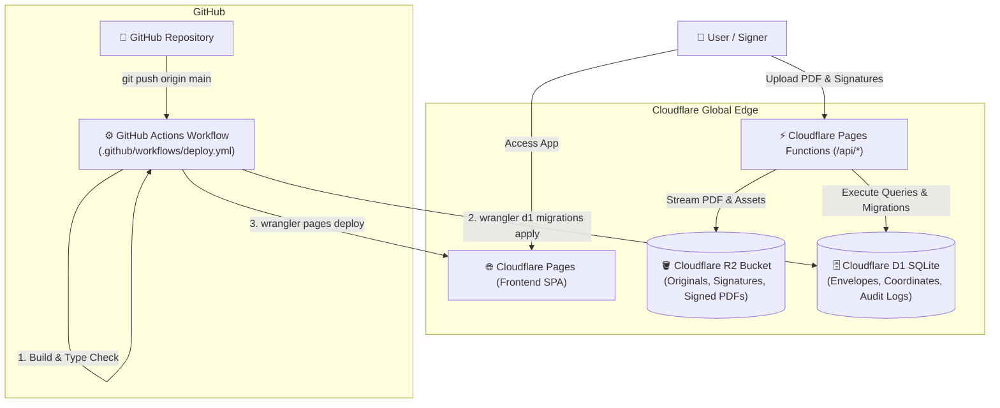

# CloudSign 🖋️⚡
> **An enterprise-grade, DocuSign-alternative built 100% on Cloudflare (Pages, Functions, R2, D1) with automated GitHub Actions CI/CD.**

[](https://pages.cloudflare.com/)
[](https://www.cloudflare.com/developer-platform/r2/)
[](https://www.cloudflare.com/developer-platform/d1/)
[](https://github.com/features/actions)
[](https://opensource.org/licenses/MIT)

---

## ✨ Features

- 📄 **Load Any Document (PDF)**: Drag and drop any PDF file with instantaneous, high-DPI client-side rendering.
- 🖋️ **Uploaded Signature with Smart Ink Isolation**:
  - Users can upload a photo or scan of their handwritten signature on paper.
  - **Auto Background Cleaner**: Intelligently strips gray/yellow paper backgrounds to 100% transparent PNG.
  - **Ink Contrast Booster**: Enhances strokes into DocuSign Navy Blue (`#0f3d82`) or Midnight Black (`#111827`).
- ✍️ **Draw & Type Signatures**: Smooth HTML5 bezier ink drawing and 4 digital cursive calligraphy fonts (*Dancing Script, Pacifico, Great Vibes, Homemade Apple*).
- 🎯 **Interactive Drag-and-Drop Placement**: Place signature, date, and name fields anywhere on any page with live resize handles and percentage coordinates.
- 📜 **DocuSign Certificate of Completion**:
  - Automatically appends a tamper-evident audit certificate page.
  - Original and Signed document **SHA-256 cryptographic checksums**.
  - Signer identity, UTC timestamp, IP address, and Cloudflare Edge colocation ID.
  - Full compliance with the **ESIGN Act** and **UETA** standards.
- ☁️ **100% Cloudflare Architecture**:
  - **Cloudflare Pages**: Static frontend delivery with 0ms cold start global caching.
  - **Cloudflare Pages Functions**: Serverless edge API routes (`/functions/api/*`).
  - **Cloudflare R2**: Zero-egress object storage for originals, signatures, and signed PDFs.
  - **Cloudflare D1**: Serverless SQLite database tracking documents, placements, and audit logs.
- 🚀 **Zero-Config GitHub Actions CI/CD**:
  - Automated linting, type-checking, D1 database schema migrations, and Pages deployment on every push to `main`.

---

## 🏛️ System Architecture



---

## 🗄️ Database Schema (`migrations/0001_initial.sql`)

- **`documents`**: Tracks envelope IDs, document titles, status (`draft`, `pending_signature`, `completed`), original & signed SHA-256 hashes, and R2 storage keys.
- **`signatures`**: Stores individual field placements (page number, `x_%`, `y_%`, `width_%`, `height_%`, signer metadata, and signature type).
- **`audit_logs`**: Tamper-evident audit timeline (action, actor, IP address, user agent, Cloudflare Ray ID, colo, and timestamps).

---

## 🚀 Quick Start Guide

### 1. Local Development
```bash
# Clone the repository
git clone <your-repo-url>
cd intelligent-goodall

# Install dependencies
npm install

# Start Vite dev server (includes client-side PDF stamping & sample NDA)
npm run dev
```

### 2. Provision Cloudflare D1 & R2 (Run Once)
Make sure you have [Wrangler](https://developers.cloudflare.com/workers/wrangler/) logged in:
```bash
npx wrangler login

# 1. Create the D1 Database
npx wrangler d1 create cloudsign-db

# 2. Create the R2 Storage Bucket
npx wrangler r2 bucket create cloudsign-documents

# 3. Apply Local or Remote Database Migrations
npm run d1:migrate:local
# Or for production:
npm run d1:migrate:remote
```

Update `wrangler.toml` with your `database_id` returned from the command above.

---

## 🔄 GitHub Actions CI/CD Setup

The repository includes a ready-to-use GitHub Actions workflow in [`.github/workflows/deploy.yml`](.github/workflows/deploy.yml).

### Required GitHub Secrets:
Go to your GitHub repository > **Settings** > **Secrets and variables** > **Actions** > **New repository secret**:

| Secret Name | Description | Where to find |
|---|---|---|
| `CLOUDFLARE_API_TOKEN` | API Token with *Cloudflare Pages:Edit* and *D1:Edit* | [Cloudflare API Tokens](https://dash.cloudflare.com/profile/api-tokens) |
| `CLOUDFLARE_ACCOUNT_ID` | Your Cloudflare Account ID | Right-hand sidebar on any dashboard page |

### Continuous Deployment:
Whenever you push changes to `main`:
```bash
git add .
git commit -m "feat: enhance signature stamping"
git push origin main
```
GitHub Actions will automatically:
1. Run type-checking & bundle the production build (`npm run build`).
2. Run database migrations against Cloudflare D1 (`wrangler d1 migrations apply`).
3. Deploy the application to Cloudflare Pages edge worldwide.

---

## 🔒 Security & Legal Compliance

- **ESIGN Act (15 U.S.C. § 7001)** & **UETA** Compliant: Captures affirmative consent, signer intent, tamper-evident cryptographic sealing, and immutable audit logs.
- **Cryptographic Hashes**: Every document is fingerprinted before and after signing with SHA-256.
- **Zero-Trust Edge**: IP addresses and Cloudflare Ray IDs are cryptographically stamped into the Certificate of Completion.

---

## 📜 License
MIT License. Created for frictionless, serverless electronic signatures on the Cloudflare edge.
